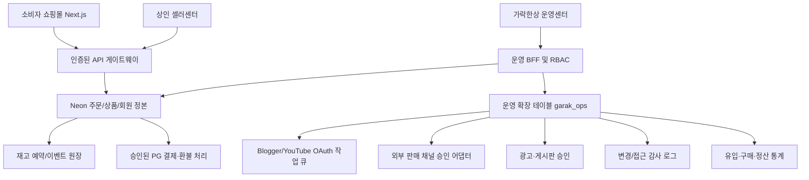
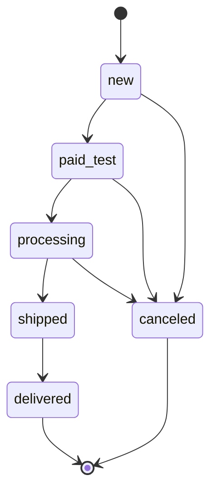

# 가락한상 운영센터 V6 — 백엔드 상세 설계서

## 1. 목적과 데이터 정본
가락한상은 B2C 식품 판매와 B2B 점포 관리, 상인 홍보·콘텐츠 커머스를 하나의 서비스로 연결한다. 운영 핵심은 **실제 확인된 상품 정보, 정확한 원화 가격, 실재고, 신뢰 가능한 주문·배송·정산 이력**이다. 레시피와 상인 게시판은 상품 구매를 보조하되 주문·결제 시스템의 정본을 덮어쓰지 않는다.

현재 베타에서는 `SQLite`를 하나의 로컬 정본으로 사용한다. 실제 운영 전환 시 기존 Next.js `lexistyle`의 Neon DB(`products`, `orders`, `orderItems`, `users` 등)를 **정본**으로 재사용하고, 운영체계 확장 테이블만 `garak_ops`로 분리한다. 가상 샘플 상인 데이터는 운영 DB로 자동 전송하지 않는다.

## 2. 논리 구성도

위 구성도는 **운영 목표 아키텍처**이며, 베타 ZIP은 로컬 Python/SQLite 운영 BFF와 정적 쇼핑몰 브리지를 실행한다. 아래 외부 시스템 연결은 실제 승인 전 비활성이다.

## 3. 도메인 및 핵심 엔터티

| 도메인 | 베타 엔터티 | 정본·검증 규칙 | 운영 연결 |
|---|---|---|---|
| 계정 | `users`,`sessions` | 역할, 세션 만료, CSRF, 로그인 제한 | Neon Auth + MFA + SSO로 전환 |
| 점포 | `merchants` | 사업자 인증 없이는 `active` 불허 | 상인 사업자 문서 별도 보관 |
| 상품 | `products` | 이름·가격·판매 상태·원산지 확인 | 기존 Neon products / images |
| 재고 | `inventory_moves` | delta, reason, 거래참조; 재고 음수 금지 | `stock_ledger` + 예약 + 반품 흐름 |
| 주문 | `orders`,`order_items` | 정본 가격 스냅샷, 상태 머신 | 기존 orders와 PG ID 매핑 |
| 출고 | `shipments` | 운송장·택배사 없으면 발송 불허 | 택배 제휴/API 정산 |
| 정산 | `settlements` | 배송완료 주문만, 주문×상인별 1개, 수수료 bp | 수수료계약, PG 수수료, 부가세, 지급증빙 |
| 레시피 | `recipes` | 조리법/사진 검수 후 공개 | CMS/스토리지/이미지 저작권 |
| 작성자 | `creators` | 실제 계정/사업자 확인 | Google OAuth·YouTube 동의 |
| 홍보 | `posts` | 작성자 신원 확인 + 광고 표시 후 승인 | 상인·유통사·협회 게시물 |
| 마케팅 | `campaigns`,`ad_events` | 예산·협찬·전환 분리 | 광고 노출/클릭/매출 어트리뷰션 |
| 고객 지원 | `tickets`,`customers` | 최소 데이터 보관, 담당자 권한 | CS 도구, 개인정보 보호 |
| 연동 | `integrations` | 실제 테스트 전 connected 상태 차단 | API 토큰 교체·작업 큐 |
| 감사 | `audit_logs` | 모든 변경의 사용자·기존값·새값 | 중앙 보안감사 보관 |
| 통계 | `page_events` | 개인 식별 불가능한 이벤트만 보관 | GA4/퍼널/중복 제거 |

## 4. 주문 상태 전이와 트랜잭션

1. 서버만 가격 결정: 제품가격은 API 조회 시점의 `products.price`, 주문 등록 시 `order_items.unit_price`에 스냅샷으로 보관한다.
2. 재고 처리: `BEGIN IMMEDIATE`로 동시 쓰기를 직렬화하고 `stock>=qty`를 검증한다. 주문·주문품목·재고·입출고 이력이 **동일 트랜잭션**에서 성공해야 한다.
3. 취소: 허용 상태에서만 취소 후 수량을 복원한다. 중복 취소는 상태 전이 거부로 재고 이중 복구를 막는다.
4. 발송: `shipments.carrier` 및 `tracking` 필수. 배송 완료 전 정산 생성 금지.
5. 정산: 주문×상인 조합의 유니크 제약을 적용해 재시도에도 중복 정산 생성 방지. 수수료(bp, 1bp=0.01%)는 원화 정수로 계산한다.
6. 운영 도입에는 PG 서버의 결제 승인 검증/취소 영수증, Webhook HMAC, 이벤트 중복 방지, 실제 배송사 조회가 추가되어야 한다. `paid_test`는 절대 실제 결제가 아니다.

## 5. 동기화·외부 채널
- **Blogger:** 사용자 소유 Google 계정 OAuth, `blogger.readonly` 또는 최소 승인 범위, 본인 블로그 목록/게시물 조회, 만료·토큰 폐기, 제품 연결 승인. 공개 게시물 복제·번역은 콘텐츠 사용권 확인 필수.
- **YouTube Shorts:** Google OAuth 승인과 영상 ID 보관, URL/썸네일 표준 임베드, 광고 표기·콘텐츠 신고·무단 재업로드 방지.
- **쿠팡 WING:** 판매자 API 자격·상품/옵션/주문 상태 매핑·Webhook/폴링 승인 후 시작. 실제 주문/재고 채널별 충돌 방지를 위해 중앙 재고 예약 필요.
- **쿠팡이츠/배달의민족:** 현재 자동 API 사용 가능한 권한·제휴 계약을 확보한 뒤 연동. 미승인 기능은 관리자에 `not_configured`로 노출.
- **토스페이먼츠:** 서버 결제금액·주문ID 검증, PG Webhook 검증, 가맹점 계약/정산 주체 및 개인정보 보안 설계 후 실결제 활성화.
- 모든 공급자는 `external_id`의 안정적인 매핑, 재시도 idempotency, 실패 큐, 관리자 수동 재동기화 및 불일치 경보 필요.

## 6. 통계 정의
- `products`: 등록 상품 개수. `published_products`: 판매 표시 허용된 상품 개수.
- `stock_units`: 상품별 수량 합계(샘플 원장에 한정), 예약 수량은 주문 시 즉시 차감.
- `gross_order_value_test`: **취소되지 않은 베타 주문 총액**. 매출·세금 신고용 값이 아니다.
- `orders`: 주문 건수, 상태별 주문 분포. `daily_sales`: 주문 발생일로 집계, 취소건 제외. 실제 운영에서는 결제·환불·정산 시점을 별도 구분한다.
- 카테고리 매출/판매수량: 주문 시점 단가 × 수량, 취소 제외. 배송 완료와 지급 완료를 실매출로 동일하게 취급하지 않는다.
- 광고 CTR = clicks/impressions, CVR = conversions/clicks. 이벤트가 없다면 0 또는 미측정으로 표시하고 절대 가상의 조회수를 채우지 않는다.
- 전환율·재구매율·유입채널 유효성을 확보하려면 GA4의 동의 기반 이벤트와 익명 세션 정합성이 필요하다. 지금은 샘플 이벤트 건수만 검증한다.

## 7. 관리자 권한 모델
`docs/RBAC_AND_SECURITY.md` 참고. 읽기 권한과 수정 권한이 다르다. UI 메뉴 숨김은 편의 기능이고 API의 **서버 RBAC**가 실권한이다. 관리자 활동은 actor_id, 이전/변경 값, UTC 시각으로 로그에 기록한다.

## 8. 배포·복구 운영
- Local Beta: Python 3.11+, SQLite WAL, `127.0.0.1` 단일 머신. SSL·MFA·중앙로그·HA가 없으므로 **인터넷 공개 금지**.
- Next.js Preview: 기존 `skvive/garak` 별도 브랜치, `npm ci`, `npm run build`, 인증·상품·주문·카테고리·레시피 계약 테스트, Vercel PREVIEW URL 격리.
- Production: Neon 연결 풀/마이그레이션 dry-run, 기존 DB 백업·복구 시험, 비밀정보 관리자, 알림·API rate limit·WAF·MFA, 전자상거래 개인정보 보호·배송 계약 확인.
- Rollback: DB migration reversible step, route versioning, 기존 build alias 복귀, 주문 원장 무결성 확인. 배포 자동 롤백은 실결제 처리 중 상태와 순서를 보존해야 한다.

## 9. 검증하지 않은 경계
Vercel 실제 배포, 프로덕션 Neon, 실거래 PG, 사업자 인증, 외부 API 승인·속도·쿼터, 법정 영수증/세금자료, 실운송장 처리, 다중 인스턴스 경합·대량 트래픽은 검증 전이다. 이 문서/ZIP만으로 운영 완성 판정을 내려서는 안 된다.
